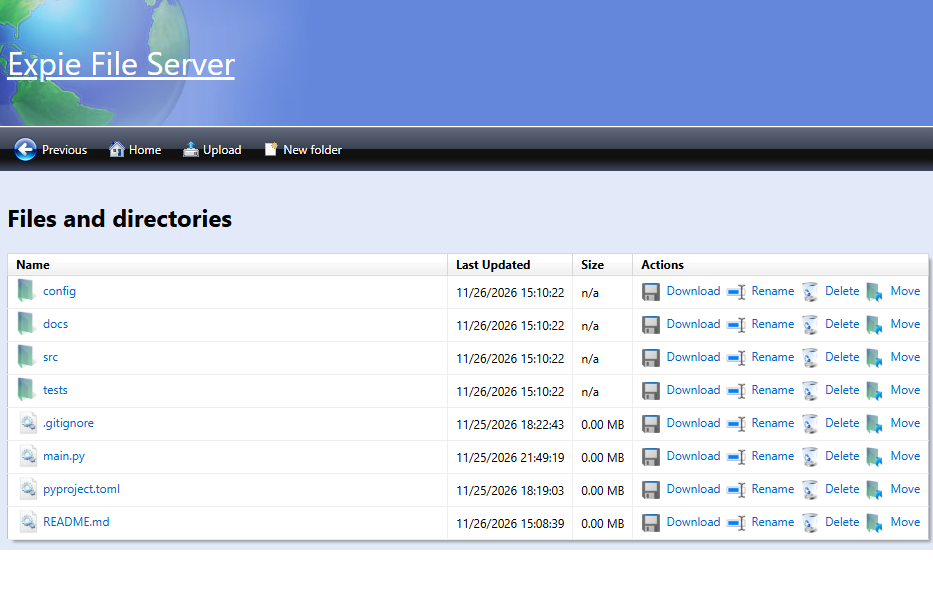

#  Expie - a self-hosted file server for your LAN


[](LICENSE)

Expie started as a small experiment that gradually evolved into a full-fledged personal project. Its name was inspired by *Casualties Unknown*, a game I was particularly enthusiastic about when development began. What started as a simple idea eventually grew into a project focused on learning, building, and exploring software engineering.


You can find additional screenshots and details about the interface design on [interface-decisions.md](docs/requirements/interface-decisions.md)

## Features
- Browse files and directories through a web interface
- Upload multiple files or entire folders while preserving directory structure
- Download individual files or directories as ZIP archives
- Create, rename, move, and delete files and directories
- Preview supported file types directly in the browser
- Serve files over your local network

## Limitations
- No support for resumable uploads or downloads.
- No built-in authentication or user management. Expie is designed for use within trusted local networks and should not be exposed directly to the public internet.

## Installation

### Requirements

- Python 3.10 or newer
- Git
- pip

### 1. Clone the repository

```bash
git clone https://github.com/Rodrigo3441/expie.git
cd expie
```

Choose a permanent location for your Expie installation. This is important if you plan to configure a `systemd` service later, as the service will need the absolute path to your project directory.

### 2. Create a virtual environment

Depending on your system, use either:

```bash
python -m venv .venv
```
Or
```bash
python3 -m venv .venv
```

**Important:**  Depending on your linux distro, you may need to install the `python3-venv` module, so you can create the `.venv`

Activate it:

**Linux:**
```bash
source .venv/bin/activate
```

**Windows:**
```powershell
.venv\Scripts\activate
```

### 3. Install dependencies

```bash
pip install .
```

If you intend to run the test suite as well, install the development dependencies:

```bash
pip install ".[dev]"
```

### 4. Configure Expie

Open `config/config.yaml` and configure the storage directory:

```yaml
default_path: '/path/to/your/storage'
default_chunk_size: 1048576

connection:
  host: localhost
  port: 3093
```

Replace `/path/to/your/storage` with the absolute path to the directory you want Expie to manage.

**Important:** Make sure the configured directory exists and is not the project directory or one of its parent/child directories.

### 5. Run Expie

```bash
uvicorn main:app --host 0.0.0.0 --port 3093
```

Once the server is running, access Expie through your browser:

```text
http://localhost:3093
```

To access it from another device on your local network, replace `localhost` with the server's local IP address.

### 6. Run tests (optional)

With the development dependencies installed and a valid configuration file in place, run:

```bash
pytest
```

## Linux Service (systemd)
Nobody wants to manually enter the same command every time they start their server. Fortunately, on Linux, you can create a systemd service to automatically start Expie for you!


### 1. Create the service file

You can either create the service file manually or use the provided template.

**Option A: Use the provided template**

Copy `deploy/expie.service.template` to `/etc/systemd/system/expie.service`:

```bash
sudo cp deploy/expie.service.template /etc/systemd/system/expie.service
```

Then, open the copied service file to update its configuration:

```bash
sudo nano /etc/systemd/system/expie.service
```
<br>


**Option B: Create it manually**

```bash
sudo nano /etc/systemd/system/expie.service
```

Add the following configuration:

```ini
[Unit]
Description=Expie LAN File Manager
After=network.target

[Service]
Type=simple
User=YOUR_USERNAME
WorkingDirectory=/path/to/expie
ExecStart=/path/to/expie/.venv/bin/uvicorn main:app --host 0.0.0.0 --port 3093
Restart=on-failure
RestartSec=5

[Install]
WantedBy=multi-user.target
```

Replace the following values:

- `YOUR_USERNAME`: The Linux user that should run Expie.
- `/path/to/expie`: The absolute path to your cloned Expie repository.
- `ExecStart`: Make sure the Uvicorn executable points to the virtual environment inside your Expie directory.

Save and close the file.

### 2. Enable and start the service

Reload systemd so it recognizes the new service:

```bash
sudo systemctl daemon-reload
```

Enable automatic startup:

```bash
sudo systemctl enable expie
```

Start Expie:

```bash
sudo systemctl start expie
```

### 3. Check the service status

Verify that Expie is running:

```bash
sudo systemctl status expie
```

You should see `active (running)` if everything started successfully.

### 4. Useful commands

| Command | Description |
|---|---|
| `sudo systemctl start expie` | Start Expie |
| `sudo systemctl stop expie` | Stop Expie |
| `sudo systemctl restart expie` | Restart Expie |
| `sudo systemctl status expie` | Check service status |
| `sudo systemctl disable expie` | Disable automatic startup |
| `sudo journalctl -u expie -f` | Follow Expie's logs in real time |

Once configured, Expie will start automatically whenever your Linux system boots, without requiring you to manually launch Uvicorn.

**Note:** The service will run as the specified Linux user, not necessarily root. Make sure that Expie has permission to perform operations on the configured folder.


## Project Structure
```bash
expie/
├── config/
│   └── config.yaml              # Configuration file for the storage directory and application settings
├── deploy/
│   └── expie.service.template   # systemd service template for Linux deployments
├── docs/                        # Project documentation
├── src/
│   └── lan_file_manager/        # Main application package
│       ├── api/                 # API configuration, endpoints, and request handling
│       ├── config/              # Configuration loading and validation
│       ├── file_management/     # Application-level file operations and path validation
│       ├── filesystem_access/   # Low-level filesystem operations
│       ├── frontend/            # Web interface templates and static resources
│       └── initialization/      # Application startup and storage directory validation
├── tests/                       # Automated tests
├── .gitignore
├── LICENSE
├── main.py                      # Application entry point
├── pyproject.toml               # Project metadata and dependencies
└── README.md
```

## Documentation

For more detailed information about Expie's architecture, design decisions, requirements, and implementation, see the [documentation](docs/README.md).


## License

This project is licensed under the MIT License - see the [LICENSE](LICENSE) file for details.

