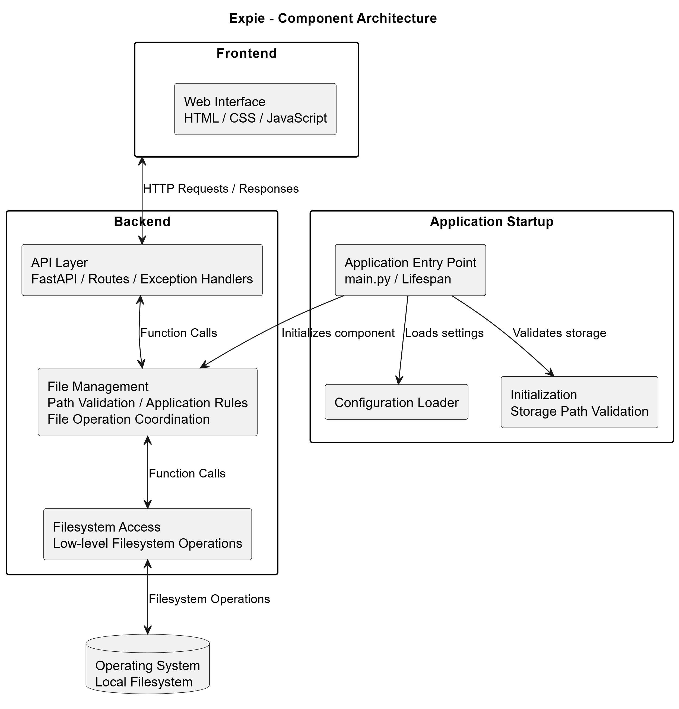

## Architecture

Expie follows a layered architecture, organized into four main components. Each component has its own responsibilities, keeping HTTP request handling, application logic, and low-level filesystem operations separated.

The request flow follows this order:

1. **Web Interface:** Provides the user interface and communicates with the backend through HTTP requests.
2. **API Layer:** Handles incoming requests, invokes the appropriate application operations, and translates exceptions into HTTP responses.
3. **File Management Layer:** Enforces application rules, validates paths, and coordinates file operations.
4. **Filesystem Access Layer:** Performs low-level operations on the operating system's filesystem.

Application configuration is loaded during startup, and the initialization component validates the configured storage directory before the application becomes available.