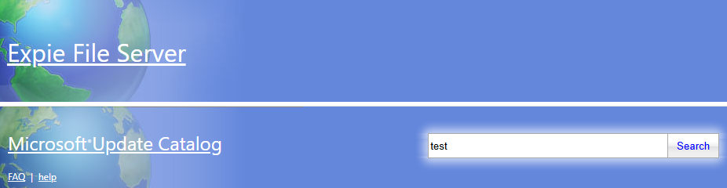
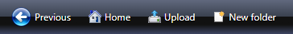
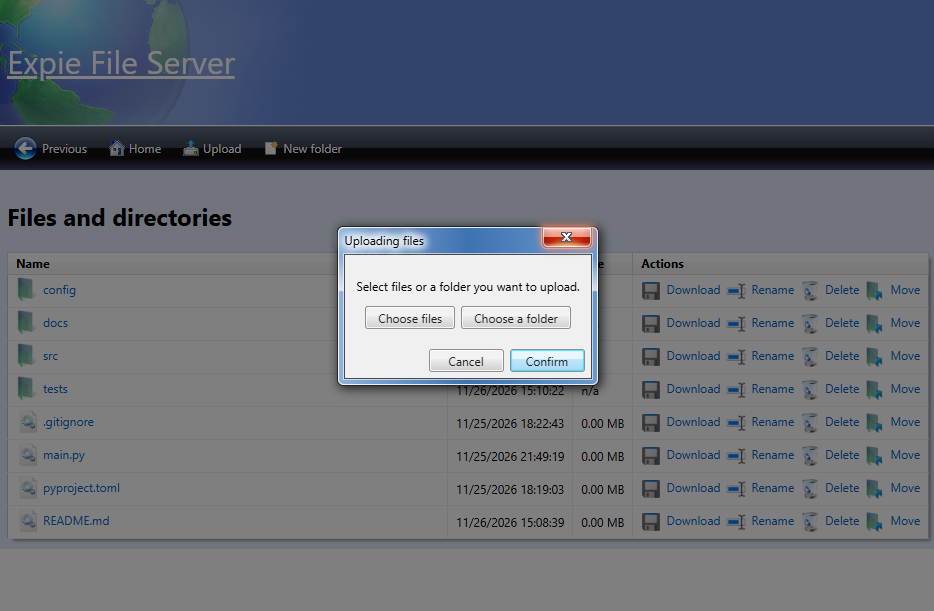
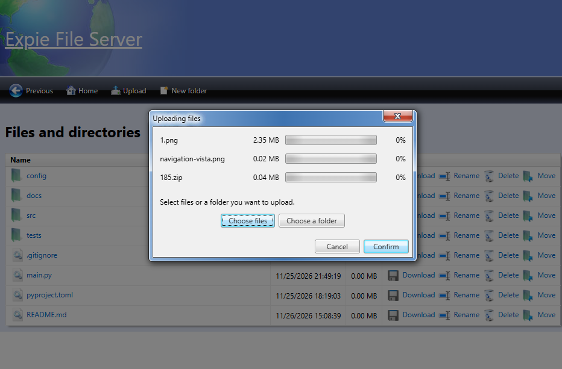
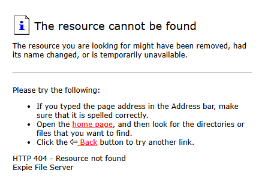

# Interface decisions

Expie uses a Windows 7-inspired visual design to create a familiar and nostalgic desktop-like experience through a web interface. The goal is to make file management feel intuitive while giving the project a distinctive visual identity.

The interface uses the [7.css](https://khang-nd.github.io/7.css/) framework as its visual foundation, complemented by familiar icons and interface elements inspired by Windows 7.

## Main Header

The main header is inspired by the header design of [Microsoft Update Catalog](https://www.catalog.update.microsoft.com/Home.aspx), a website that distributes update packages.
 

I am not sure why i did get the idea of using this aesthetic.

## Icons

Expie revives the classic Windows and Internet Explorer Icons

#### Navigation bar icons 

#### Action button icons

## Dialogs

## 404 page
The 404 page is inspired by the old internet explorer eror page.

## The Favicon

As mentioned in the main README, Expie's name originated from my enthusiasm for [Casualties Unknown](https://store.steampowered.com/app/4576490/Casualties_Unknown/?l=english) when I first started the project. The favicon was meant to reflect that inspiration, giving the project a small personal touch and connecting its visual identity to its origins.

